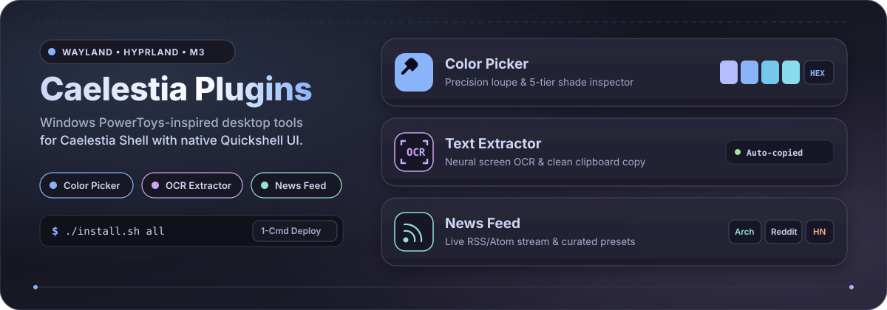

<p align="center">
  
</p>

<p align="center">
  <a href="#-quick-install"></a>
  <a href="#-included-plugins"></a>
  <a href="https://github.com/hyprwm/Hyprland"></a>
  <a href="https://quickshell.outfoxxed.me/"></a>
  <a href="./LICENSE"></a>
</p>

---

## ⚡ Quick Install

Install and configure the complete plugin suite on any device running **Caelestia Shell**:

```bash
git clone https://github.com/GopikChenth/Caelestia-Plugin.git ~/.config/caelestia/plugins-repo
cd ~/.config/caelestia/plugins-repo
./install.sh all
```

> [!TIP]
> The automated installer detects missing dependencies on Arch (`pacman`), Fedora (`dnf`), Ubuntu/Debian (`apt`), and openSUSE (`zypper`), creates module symlinks, registers system CLI shortcuts, and syncs Hyprland keybindings.

<details>
<summary><b>Advanced Installation &amp; Management Options</b></summary>

```bash
./install.sh all                 # Install all plugins (default)
./install.sh color-picker        # Install only Color Picker
./install.sh text-extractor      # Install only Text Extractor (OCR)
./install.sh news-feed           # Install only News Feed
./install.sh --link              # Symlink files instead of copying (for active dev)
./install.sh -y all              # Non-interactive mode (auto-accepts package installations)
./install.sh --check             # Check status of system dependencies & plugins
./uninstall.sh [all|plugin]      # Clean uninstaller
```

</details>

---

## 📦 Included Plugins

### 1. 🎨 Color Picker
A multi-format screen color sampler and shade inspector powered by `hyprpicker`.

- **Engine**: `hyprpicker`, `wl-copy`, `notify-send`
- **Supported Formats**: HEX, HEX (no `#`), RGB, HSL, HSV, CMYK
- **Key Features**:
  - Live magnifier loupe with Euclidean color name matching
  - 5-tier luminance shade generator
  - Dynamic HSV/RGB fine-tuning sliders
  - Persistent color history with quick copy
- **Access Points**: `SUPER + SHIFT + C`, Nexus Settings, Bar Widget, Drawer Quick Toggle, CLI (`caelestia-color-picker`)

### 2. 🔍 Text Extractor (OCR)
Instant optical character recognition for any screen region powered by neural LSTM OCR.

- **Engine**: `slurp` + `grim` (Wayland capture) + `tesseract 5.5` (LSTM engine) + `wl-copy`
- **Key Features**:
  - Interactive rectangular region selection with customized crosshair overlay
  - Multi-language recognition support (`eng`, `spa`, `fra`, `deu`, `jpn`, etc.)
  - Multi-format copy toolbar: Plain Text, Single-line Cleaner, Markdown, UPPERCASE, lowercase, and JSON string
  - Persistent capture history and instant notification feedback
- **Access Points**: `SHIFT + SUPER + T`, Nexus Settings, Bar Widget, Drawer Quick Toggle, CLI (`caelestia-text-extractor`)

### 3. 📰 News Feed
Curated RSS & Atom feed reader and notification center for Midnight / Caelestia Shell.

- **Engine**: Native Quickshell XML/JSON networking (`XMLHttpRequest`, `FileView`, `xdg-open`)
- **Key Features**:
  - Multi-feed aggregation with live feed testing & validation
  - 1-click curated presets (Arch Linux News, CachyOS, Phoronix, Hacker News, GamingOnLinux)
  - Persistent synchronization with `~/.config/caelestia/news.json`
  - Dynamic sidebar reader with read/unread tracking
- **Access Points**: Sidebar Reader (`News.qml`), Nexus Settings, Bar Widget, Drawer Quick Toggle, CLI (`caelestia-news-feed`)

---

## ⌨️ Shortcuts & CLI Commands

| Plugin | Keybinding | CLI Trigger | Action |
| :--- | :--- | :--- | :--- |
| **Color Picker** | <kbd>SUPER</kbd> + <kbd>SHIFT</kbd> + <kbd>C</kbd> | `caelestia-color-picker` | Pick screen color & open inspector |
| **Text Extractor** | <kbd>SHIFT</kbd> + <kbd>SUPER</kbd> + <kbd>T</kbd> | `caelestia-text-extractor` | Drag screen region & copy OCR text |
| **News Feed** | *(Configurable)* | `caelestia-news-feed` | Toggle news sidebar (`open`, `next`, `reload`) |

---

## 🏗️ Architecture & Module Structure

Every plugin is completely self-contained with its own manifest, settings, service singleton, UI cards, and standalone installer:

```text
Caelestia Plugins/
├── assets/
│   └── readme/
│       └── hero.svg               # Material 3 showcase banner
├── color-picker/                  # Color Picker Plugin (Self-contained)
│   ├── manifest.json              # Plugin metadata & entry points
│   ├── settings.json              # User preferences & color history
│   ├── ColorUtils.js              # Color conversion & math utilities
│   ├── ColorService.qml           # Core process & state singleton
│   ├── ColorEditorCard.qml        # Color inspector card UI
│   ├── ColorEditorWindow.qml      # Floating window component
│   └── caelestia-color-picker     # CLI activation launcher
├── news-feed/                     # News Feed Plugin (Self-contained)
│   ├── manifest.json              # Plugin metadata & entry points
│   ├── settings.json              # Initial preferences & preset URLs
│   ├── News.qml                   # Live sidebar reader component
│   ├── NewsUtils.js               # RSS/Atom XML parser
│   ├── NewsService.qml            # Feed caching & networking singleton
│   └── caelestia-news-feed        # CLI activation launcher
├── text-extractor/                # Text Extractor OCR Plugin (Self-contained)
│   ├── manifest.json              # Plugin metadata & entry points
│   ├── settings.json              # User preferences & OCR history
│   ├── extract.sh                 # Native Wayland OCR pipeline runner
│   ├── TextUtils.js               # String formatting utilities
│   ├── TextService.qml            # OCR process & state singleton
│   ├── TextExtractorCard.qml      # OCR inspector card UI
│   └── caelestia-text-extractor   # CLI activation launcher
├── install.sh                     # Master universal multi-distro installer
├── uninstall.sh                   # Master universal uninstaller
└── scan-plugins.py                # Dynamic multi-path plugin discovery scanner
```

---

## 🛠️ Automated Setup Workflow

When `install.sh` runs, it executes the following pipeline:

1. **Dependency Resolution**: Queries package manager (`pacman`, `dnf`, `apt`, `zypper`) for missing binaries (`hyprpicker`, `grim`, `slurp`, `tesseract`, `wl-clipboard`).
2. **Directory Initialization**: Creates standard paths in `~/.config/caelestia/plugins/` and `~/.config/quickshell/caelestia/modules/`.
3. **Module Linking**: Links Quickshell modules so `shell.qml` imports resolve seamlessly.
4. **Binary Placement**: Installs wrappers into `~/.local/bin/` for instant terminal and shortcut execution.
5. **State Registration**: Enables all active plugins in `~/.config/caelestia/plugins-state.json`.
6. **Hyprland Rules**: Injects keybindings and floating window rules into `~/.config/caelestia/hypr-user.lua` or `~/.config/hypr/hyprland.conf`.
7. **Nexus Settings**: Integrates control panels under **Nexus Settings &rarr; System &rarr; Plugins**.
